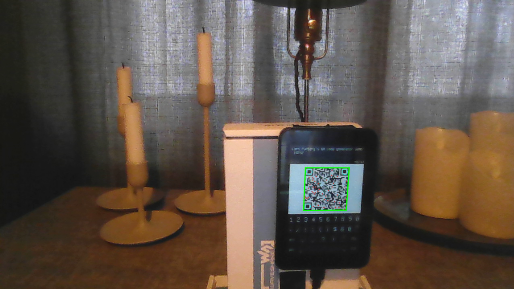

# QR codes on the Waveshare ESP32-S3-Touch-LCD-3.5 (ESP-IDF)

Type text on an on-screen keyboard and get a live QR code on the 3.5" 320x480
ST7796 display, using the minimal-RAM `qrcode.c` / `qrcode.h` library.

Screen layout (portrait): text field (3 lines, blinking cursor) / `QR v5-H ... 26/44`
character counter / QR code / 4-row keyboard.
- Keyboard layers: letters, `?123` (digits + common symbols), `#+=` (remaining ASCII symbols). All 95 printable ASCII characters are reachable.
- SHIFT: tap = next letter capital, double-tap = CAPS lock (turns amber), tap again = off.
- DEL: hold to repeat. CLR clears everything. The BOOT button also clears.
- The counter is `characters / capacity`; capacity is measured at boot from the library itself for the configured version and ECC level (v5-H = 44, v5-M = 84, v10-M = 213). It turns red at the limit and further keys are ignored.

Requires **ESP-IDF v5.5.0 or newer** (Waveshare's requirement for this board).

## Open and build in VS Code
1. Install the **ESP-IDF** extension (`espressif.esp-idf-extension`) and an ESP-IDF >= 5.5 via its setup wizard.
2. `File > Open Folder...` and choose this folder.
3. Command palette: **ESP-IDF: Set Espressif Device Target** -> `esp32s3` (chip target, "ESP32-S3 chip (via builtin USB-JTAG)").
4. **ESP-IDF: SDK Configuration Editor** -> *QR demo* (your messages), *Component config > QR code generator* (version / ECC), *Waveshare ESP32-S3-Touch-LCD-3.5 board* (pins etc.).
5. **ESP-IDF: Build, Flash and Monitor** (the flame icon), select the board's COM port / `/dev/ttyACM*`.
   If flashing does not start, hold BOOT while plugging in USB, then flash.

Command line equivalent: `idf.py set-target esp32s3 && idf.py build flash monitor`.

## Changing the QR size
QR version and ECC level are **build-time** constants (library design): menuconfig -> *Component config > QR code generator*.
Higher version = more characters but smaller modules; version 20 (858 chars at L) still fits the screen at 1 px/module, so use 8-12 for anything you want to scan from the display.
The text field shows the last 3 lines (37 chars each) when the string gets longer.

## Hardware assumptions (from the Waveshare schematic)
| Function | Pin |
|---|---|
| LCD SPI MOSI / SCLK / DC | GPIO1 / GPIO5 / GPIO3 (LCD_CS is tied low, no GPIO) |
| LCD reset | TCA9554 EXIO1 (I2C 0x20) |
| Backlight | GPIO6 (active high, LEDC PWM) |
| I2C SDA / SCL (TCA9554, FT6336 0x38, ...) | GPIO8 / GPIO7 |
| BOOT button | GPIO0 |

Everything above is a Kconfig option. Console output uses the native USB Serial/JTAG (`sdkconfig.defaults`).
PSRAM is not needed and left disabled.
